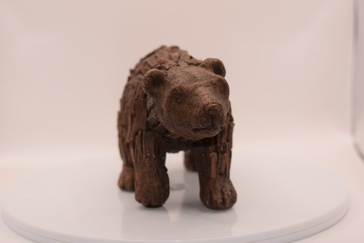
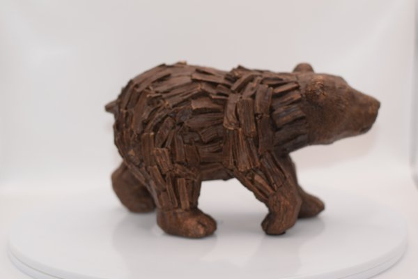
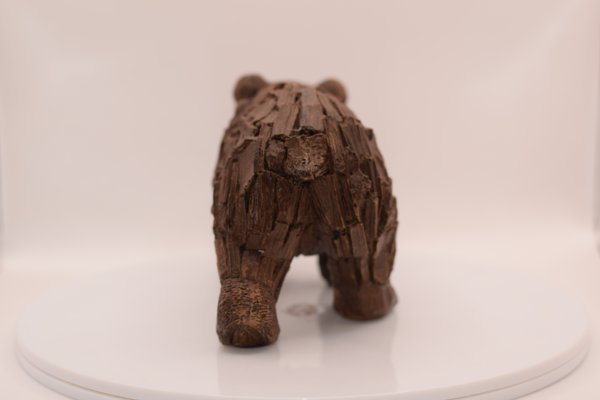
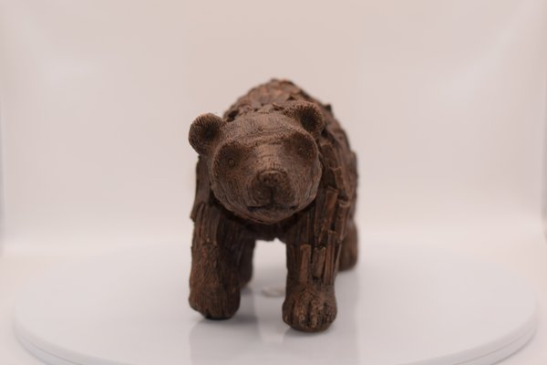
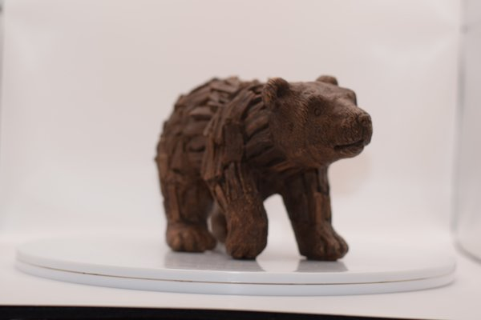
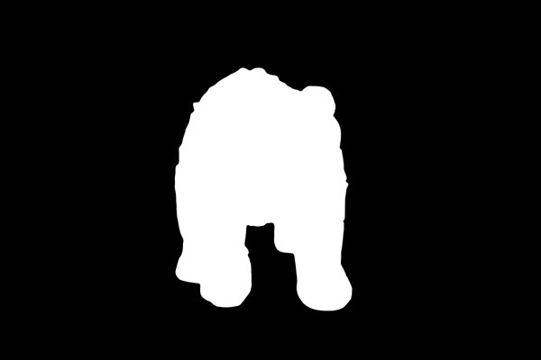
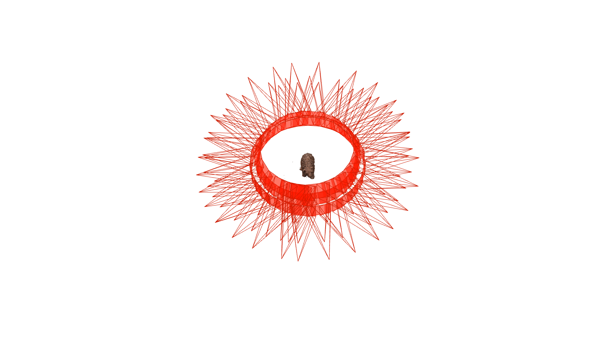
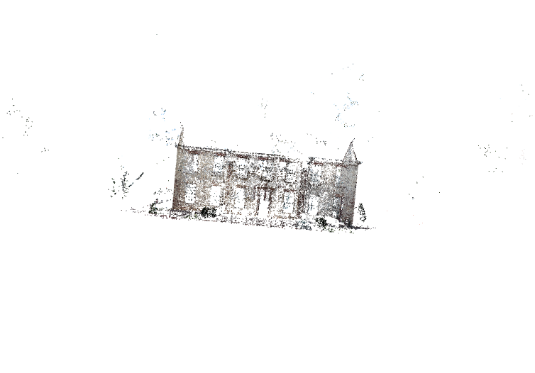
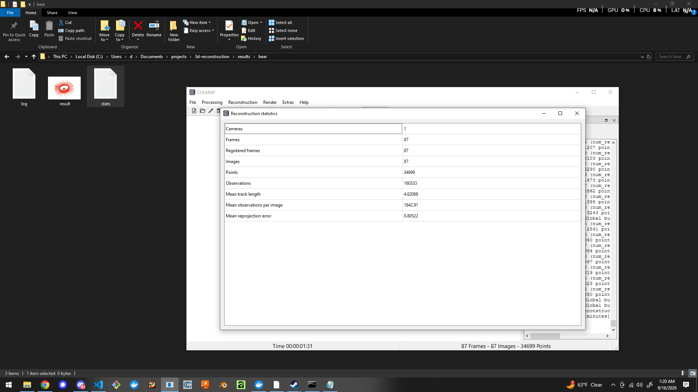

# 3D reconstruction

A comparison of three 3D reconstruction traditional and modern techniques, run on the same
captured scenes.

The techniques compared
- COLMAP (SfM + MVS)
- 3D Gaussian Splatting
- NeRF

## Data

Two capture sets:
- **bear** — a small object, photographed and reconstructed both with
  and without background masking. Masks are generated with
  [`rembg`](https://github.com/danielgatis/rembg) via
  `scripts/create_masks.py`.
- **gerrard-hall** — a building scene, COLMAP's standard sample
  dataset.

### Images

#### Front

#### Side

#### Behind

#### Higher

#### Lower

#### Mask

## Traditional

### COLMAP

#### SfM

Feature extraction, matching, and incremental mapping produce a
sparse point cloud and camera poses.

Reconstruction stats for the bear scan:

#### MVS

Dense multi-view stereo + fusion is run on top of the sparse model to
produce a dense point cloud (see `colmap/*/dense/` — not tracked in
this repo due to size).

## Modern

### 3D Gaussian Splatting

### NeRF
# 3d-reconstruction
